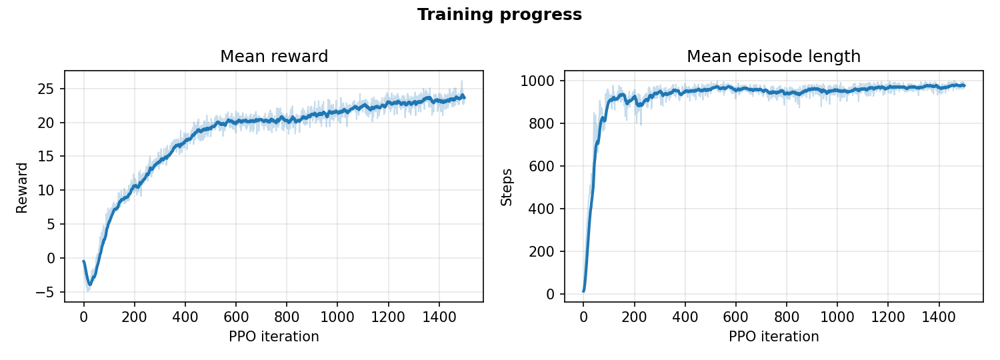
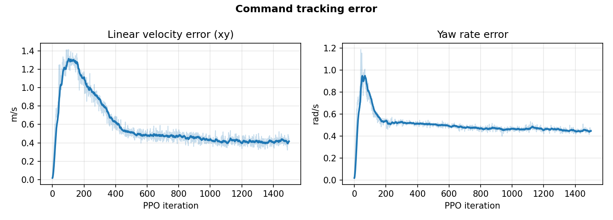
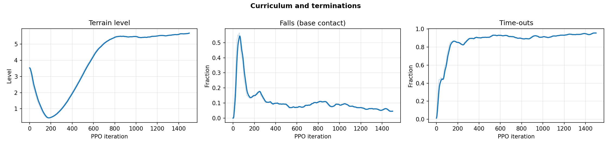
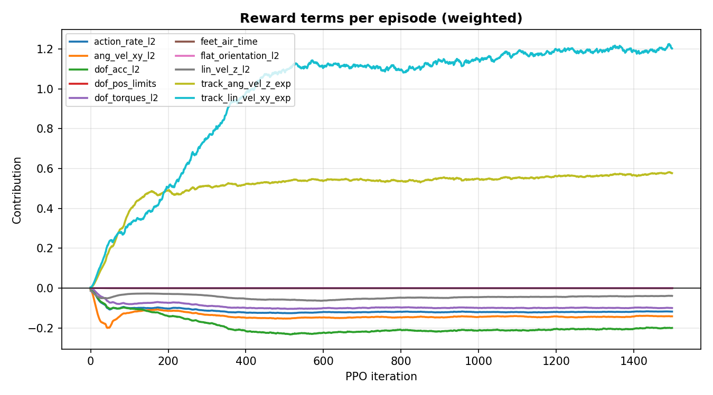
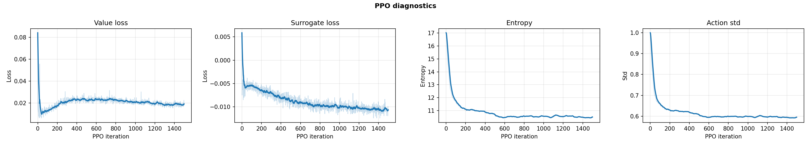

<h1 align="center">Go2 Rough-Terrain Locomotion with PPO</h1>

<p align="center">
  Training a Unitree Go2 quadruped to walk over rough terrain with deep reinforcement learning,<br/>
  in NVIDIA Isaac Lab, with live keyboard control of the learned policy.
</p>

<p align="center">
  <!-- Replace with your demo GIF (see "Making the media" at the bottom) -->
  
</p>

<p align="center">
  
  
  
  
</p>

---

## Overview

A 12-DoF quadruped learns to **follow velocity commands** (forward/backward, sideways, turning) while walking over **procedurally generated rough terrain**, with no hand-designed gait. The policy only sees its own body state, the command, and a height scan of the ground around it, and outputs target joint positions 50 times a second.

The policy is trained with **Proximal Policy Optimization (PPO)** across **4,096 parallel simulated robots** on a single laptop GPU, using a **terrain curriculum** that promotes robots to harder terrain as they improve.

<table align="center">
  <tr>
    <td align="center"><b>147.5 M</b><br/><sub>environment steps</sub></td>
    <td align="center"><b>2 h 36 min</b><br/><sub>training on one laptop GPU</sub></td>
    <td align="center"><b>95.4 %</b><br/><sub>episodes completed without a fall</sub></td>
  </tr>
</table>

**What this repository contains**

- A rough-terrain velocity-tracking policy for the Unitree Go2, trained with PPO on a terrain curriculum
- Keyboard teleoperation of the trained policy, with a follow camera and live commanded-vs-actual velocity readout (`scripts/keyboard_play.py`)
- A plotting script that turns TensorBoard logs into report-ready figures (`scripts/plot_training.py`)

<p align="center">
  &nbsp;
  
</p>

---

## The RL problem (MDP)

### Observations (235 dims)

| Term | Dims | Meaning |
|---|---|---|
| `base_lin_vel` | 3 | Body linear velocity (body frame) |
| `base_ang_vel` | 3 | Body angular velocity (body frame) |
| `projected_gravity` | 3 | Gravity direction in body frame (body orientation) |
| `velocity_commands` | 3 | Commanded `v_x`, `v_y`, `ω_z` |
| `joint_pos` | 12 | Joint angles (relative to default stance) |
| `joint_vel` | 12 | Joint velocities |
| `actions` | 12 | Previous action, for temporally smooth control |
| `height_scan` | 187 | Grid of terrain heights around the robot (ray-cast) |

### Actions (12 dims)
Target joint positions (offsets from the default standing pose) for all 12 joints, tracked by low-level PD controllers.

### Reward (10 terms)

| Term | Weight | Purpose |
|---|---:|---|
| `track_lin_vel_xy_exp` | **+1.5** | Follow commanded forward/sideways velocity |
| `track_ang_vel_z_exp` | **+0.75** | Follow commanded turning rate |
| `lin_vel_z_l2` | −2.0 | Penalise bouncing up and down |
| `ang_vel_xy_l2` | −0.05 | Penalise rolling / pitching |
| `dof_torques_l2` | −2e-4 | Energy efficiency |
| `dof_acc_l2` | −2.5e-7 | Smooth joint motion |
| `action_rate_l2` | −0.01 | Avoid jittery actions |
| `feet_air_time` | +0.01 | Encourage proper stepping (lifting feet) |
| `flat_orientation_l2` | 0.0 | Disabled for rough terrain |
| `dof_pos_limits` | 0.0 | Disabled |

The two positive tracking terms define the task; everything else is a regulariser that shapes *how* the robot walks.

### Episodes, terminations and randomisation
- **Episode length:** 20 s (1,000 policy steps at 50 Hz)
- **Terminations:** time-out, or the robot's base touching the ground (a fall)
- **Domain randomisation (startup):** ground friction (`physics_material`), extra payload on the base (`add_base_mass`)
- **Reset:** random base pose/velocity and joint positions
- **Curriculum:** `terrain_levels`. Robots that walk far enough are promoted to harder terrain; robots that fail are demoted

---

## Training

**Algorithm:** PPO (`rsl_rl`), actor-critic MLPs

| Hyperparameter | Value |
|---|---|
| Parallel environments | 4,096 |
| Steps per env per iteration | 24 |
| Iterations | 1,500 |
| Actor / critic network | `[512, 256, 128]`, ELU |
| Learning rate | 1e-3, adaptive (target KL 0.01) |
| Discount γ / GAE λ | 0.99 / 0.95 |
| Clip ratio | 0.2 |
| Epochs × mini-batches | 5 × 4 |
| Entropy coefficient | 0.01 |
| Initial action std | 1.0 |
| Seed | 42 |

### Results

| Metric | Final value |
|---|---|
| Total environment steps | 147.5 M |
| Wall-clock training time | 9,350 s (~2 h 36 min) |
| Throughput | ~16,500 steps/s |
| Mean episode length | 965 / 1,000 steps |
| Episodes ending in time-out (survived) | 95.4 % |
| Episodes ending in a fall | 4.6 % |
| Terrain curriculum level reached | 5.69 |
| Linear velocity tracking error (xy) | 0.43 m/s |
| Yaw-rate tracking error | 0.45 rad/s |

<p align="center">
  
</p>
<p align="center">
  
</p>
<p align="center">
  
</p>

<details>
<summary><b>More plots: per-term rewards and PPO diagnostics</b></summary>
<p align="center">
  
  
</p>
</details>

**Observations from training**
- Episode length climbs to nearly the 20 s maximum, so the policy learns to stay upright early; most remaining improvement is in **tracking accuracy** and **curriculum level**.
- The `feet_air_time` term stays close to zero, suggesting the policy takes short, low steps rather than a high-clearance trot. This is a natural target for further reward tuning.

---

## Keyboard demo

Drive the trained dog yourself. The policy still produces every joint command; the keyboard only changes the **velocity command** it was trained to follow.

```bash
ipy scripts/keyboard_play.py --task <TASK_ID> \
    --checkpoint logs/rsl_rl/unitree_go2_rough/<run>/model_1499.pt --real_time
```

| Key | Action |
|---|---|
| ↑ / ↓ | Walk forward / backward |
| ← / → | Strafe left / right |
| Z / X | Turn left / right |
| L | Stop (zero command) |

Options: `--cam_eye X Y Z` (follow-camera offset, e.g. `0 -3 0.8` for a side view), `--no_follow` (free camera), `--num_envs N`.
Green arrow = commanded velocity, blue arrow = actual velocity. Keyboard commands are clamped to the ranges seen in training.

**Full demo video:** <!-- paste the GitHub video link here (drag the .mp4 into the README editor on github.com) -->

---


## Repository map

| What | Where |
|---|---|
| Environment config (scene, obs, actions, rewards, terrain) | `source/go2_locomotion_rl/go2_locomotion_rl/tasks/manager_based/go2_locomotion_rl/` |
| PPO hyperparameters | `.../agents/rsl_rl_ppo_cfg.py` |
| Task registration | `.../__init__.py` |
| Train / play | `scripts/rsl_rl/train.py`, `scripts/rsl_rl/play.py` |
| Keyboard teleop | `scripts/keyboard_play.py` |
| Plotting | `scripts/plot_training.py` |
| Figures, GIFs | `docs/media/` |

<!-- Fix the paths above to match your tree exactly. -->

---

## Limitations and future work
- **Single seed (42).** Results are not averaged over multiple runs.
- **Simulation only.** No sim-to-real transfer onto a physical Go2.
- **Low foot clearance** (see `feet_air_time`). Reward tuning or a gait-shaping term could produce a cleaner trot.
- **Hierarchical navigation.** Use this policy as the frozen low-level controller for a learned navigation policy, as in my earlier HelixNav project.

---

## Acknowledgements
- The training approach (massively parallel PPO, terrain curriculum, velocity-tracking reward design) is inspired by **Rudin et al., ["Learning to Walk in Minutes Using Massively Parallel Deep Reinforcement Learning"](https://arxiv.org/abs/2109.11978), CoRL 2021**.
- PPO implementation: [rsl_rl](https://github.com/leggedrobotics/rsl_rl) (Robotic Systems Lab, ETH Zürich).
- Locomotion setup adapted from my earlier HelixNav quadruped-navigation project.

<!--
## Making the media (delete this section before publishing)

GIF from your screen recording (cut a 6–10 s clip, keep under ~10 MB):
  ffmpeg -ss 00:00:05 -t 8 -i demo.mp4 -vf "fps=15,scale=720:-1:flags=lanczos,split[a][b];[a]palettegen[p];[b][p]paletteuse" -loop 0 docs/media/demo.gif

Full video: on github.com, edit README.md, drag the .mp4 (<100 MB) into the editor; GitHub inserts a playable link.

Screenshot: in Isaac Sim, Window > Viewport > camera icon, or just a normal screenshot of many robots on the terrain.
-->